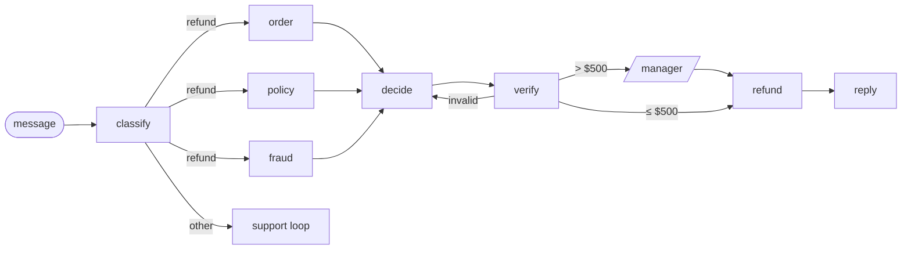

# 00 · The baseline

The refund agent we start from, carried over unchanged from [graph engineering from first principles](https://github.com/brahim-guaali/graph-engineering-from-first-principles) (its last stage). It lives in [`agent/`](../agent/), and every later stage grows that package.



Two model judgments (classify, decide), everything else code: three lookups in parallel, a verifier, a manager for refunds over $500, an idempotency key on the payment, SQLite checkpoints so a run can wait for the manager and resume in another process.

## Run it

```bash
make platform                               # terminal 1, on :8710
python 00-baseline/run.py                   # terminal 2: happy | twice | support
```

## Real run (Gemini free tier, 2026-10-20)

| Scene | Result |
|---|---|
| $640 late catering | Paused for the manager, resumed, refunded $640 under §1. 2 model calls, 672 tokens in, 1,449 out |
| Same $72 request on two days | **Refunded twice: $144 for a $72 order** |
| Rude rider complaint | Support loop filed a rider ticket and replied |

Full output: [`output.txt`](output.txt).

## Where it breaks

It works on twelve hand-written messages, one turn each, against services that either answer or hang. Real support isn't like that:

- **No memory.** Each run starts from nothing. The idempotency key stops one run from paying twice, but a second run for the same order is a new key, so the customer was paid twice. The agent also can't see that a customer has claimed five refunds this month.
- **One turn only.** "Why only $72?" would be a brand-new run with no idea what was said before.
- **Services only hang.** Real services answer `500`, return half a record, or say `404`.
- **No traffic.** Twelve runs say nothing about p95 latency, cost per day or drift.
- **No signal from outside.** Nobody knows if the customer was happy, or which prompt and model version produced an answer.

Stages 01–08 fix these, one or two at a time. Next: [01 · memory](../01-memory/).
