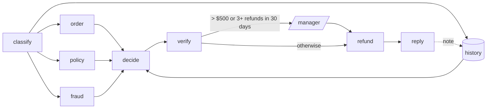
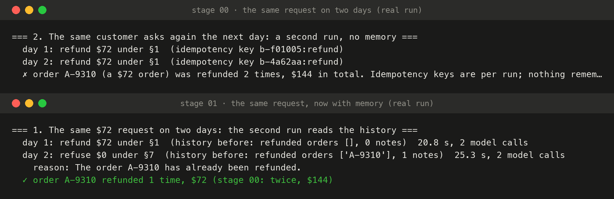

# 01 · Memory

The baseline forgot every customer the moment a run ended, so it paid the same $72 refund twice on two different days. This stage gives it a memory: the platform remembers, and the agent reads that memory before it decides and writes to it when it's done.



## What changed

| Where | Change |
|---|---|
| Platform | `GET /customers/{id}/history`: past refunds (seeded, plus every payment made since), how many in the last 30 days, which orders were already refunded, and the notes earlier runs left. `POST /customers/{id}/notes` to write one |
| Policy (v4) | §7: an order already refunded gets no second refund. §8: three or more refunds in 30 days and any refund needs a manager |
| Agent | `history` is a fourth lookup in the same parallel step. `decide` sees it as a fact. The verifier rejects a refund on an order already refunded (§7 is checked in code, not trusted to the model). The route to the manager checks §8 in code. `reply` leaves a one-line note for the next run |
| Cases | Two new ones that need memory: `already-refunded` and `frequent-claimer` (14 in total) |

The memory is *read* and *written*: payments and notes made by one run are what the next run retrieves. In part 2 this read becomes a retrieval span, the kind of step that explains a decision ("refused because the history said so").

## Run it

```bash
make platform                          # terminal 1
python 01-memory/run.py                # twice | frequent | cases
```

## Real run (Gemini free tier, 2026-10-20)

| Scene | Result |
|---|---|
| Same $72 request on two days | Day 1: refund $72 under §1. Day 2: the history showed A-9310 already refunded → **refuse under §7**. Paid once, $72 (stage 00: twice, $144) |
| $15 missing milkshake, 4 refunds this month | Refund $15, **sent to the manager** because of §8 (the amount alone wouldn't have) |
| All 14 cases | **14/14 right** (12 old, 2 new), 29 model calls, 12,711 tokens, median 45 s per case |

One thing the numbers hide: the model cited §8 as the clause for the $15 refund, where §2 (missing items) sets the amount. The answer was right and nothing checks the citation. Evals catch this kind of thing (part 3).

### Why 45 seconds a case: we found it by accident

The trace events showed each model call taking about 20 s and each lookup 2 s. A probe after the run explained it: **Gemini 3.5 Flash's free tier allows 20 requests a day per project**, and we were past it. So almost every call got a `429`, waited out two back-offs, and then fell back to Flash-Lite, which answered in under a second. The run "worked", 14/14, on a different model than the one configured, and nothing in the output said so.

From here on, the Gemini client records which model answered every call (`Usage.models`), and the stages run on Flash-Lite first (`GEMINI_MODEL`). In part 2 this becomes a span attribute (`gen_ai.response.model`) and a fallback event, so a silent switch like this shows up on a dashboard instead of in a probe.



*Stage 00's and stage 01's real output for the same $72 request on two days ([`../00-baseline/output.txt`](../00-baseline/output.txt), [`output.txt`](output.txt)), rendered with [`viz/terminal.py`](../viz/terminal.py).*

Full output: [`output.txt`](output.txt).

## Where it breaks

- **One turn only.** When the day-1 customer writes back "why only $72?", that's a new run. It sees the note, but not the conversation it belongs to. Next: [02 · conversations](../02-conversations/).
- **Slow calls, rate limits and fallbacks are invisible.** We only found the 20-second calls because the viewer's events carry timings, and the cause only with a separate probe. That's part 2's job.
