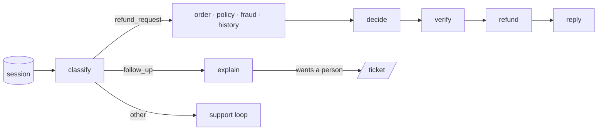

# 02 · Conversations

Customers don't send one message. After a $72 refund they write back "why only $72?". In stage 01 that was a brand-new run: the agent saw a note about the refund but not the conversation, and the message read like a fresh request with no order in it.

Now every run belongs to a **session**. The customer's message and the agent's reply are stored as turns, `classify` reads the conversation so far, and a follow-up goes to a new node, `explain`, which answers from the session and the decisions on record, or hands the customer to a person. Explaining never moves money.



## What changed

| Where | Change |
|---|---|
| Platform | `POST /sessions/{id}/turns`, `GET /sessions/{id}`: the conversation, turn by turn, each turn tagged with the run that wrote it |
| Agent | A `session` node first (loads earlier turns, stores the new message). `classify` sees the conversation and can answer `follow_up`. `explain` (a third model judgment) answers it or sets `wants_person`. Every ending (`reply`, `explain`, `support`, `escalate`) stores the agent's turn |
| Routing | A follow-up with no earlier turns has nothing to explain, so it goes to the support loop |

One conversation is now **several runs**. That's the shape observability tools call a *session* (OpenTelemetry's `gen_ai.conversation.id`): in part 3 every span carries the session id, so the three runs below show up as one conversation.

## Run it

```bash
make platform
python 02-conversations/run.py         # chat | alone
```

## Real run (gemini-3.5-flash-lite, 2026-10-20)

| Turn | Path | Time | Agent |
|---|---|---|---|
| "A-9310 arrived 50 minutes late. Refund please." | refund_request → refund $72 | 8.6 s | full refund of $72 |
| "Why only $72? I also paid $6 for delivery and a $5 tip." | follow_up → explain | 15.5 s | the refund covers the order total under the policy; fees and tips aren't part of it |
| "That's not fair. I want to talk to a person about the tip." | follow_up → explain → ticket | 15.0 s | a colleague will review it; ticket opened |

One session, 6 turns from 3 runs, A-9310 paid once. Each turn took 2 model calls on Flash-Lite (about 650–750 tokens in).

The same "why only $72?" sent in a **new** session was classified `follow_up` with no order, found nothing to explain, and went to the support loop, which opened a ticket (22.3 s).

Full output: [`output.txt`](output.txt).

## Where it breaks

- **The answer said more than the facts.** "Delivery fees and tips are excluded" sounds right, but the policy never mentions fees or tips: the model filled the gap. Nothing checks that an explanation is *grounded* in the policy and the record. That's an eval (part 4).
- **One agent does everything.** Fraud review is a single score from one endpoint, and policy questions are answered from the whole policy pasted into a prompt. Real systems hand pieces of work to specialised agents, and a trace needs to show who did what. Next: [03 · sub-agents](../03-sub-agents/).
