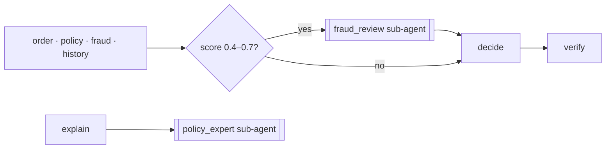
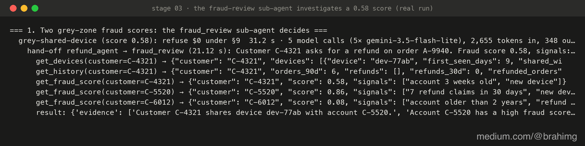

# 03 · Sub-agents

Some work is too open-ended for one fixed step. A fraud score of 0.58 isn't clearly fine or clearly fraud: someone has to dig. And "why only $72?" needs the right policy text, not the whole policy pasted into a prompt. So the main agent hands these jobs to two **sub-agents**, specialists with their own instructions, their own tools and their own loop:

| Sub-agent | Called by | Tools | Returns |
|---|---|---|---|
| `fraud_review` | the graph, when the fraud score is 0.4–0.7 (§9) | `get_devices`, `get_history`, `get_fraud_score` (of any account) | `{risk: low/high, evidence: [...]}` |
| `policy_expert` | the `explain` node | `search_policy` (clauses §1–§9 and FAQ F1–F5) | `{answer, sources: [§1, F2…], covered}` |



A sub-agent ends by calling `finish` with a typed result, so the graph gets data, not prose. The verifier holds the decision to it (a high-risk review means refuse, §9, whatever the main model says). Every hand-off is kept in the state as a record: who asked, which sub-agent, the task, each tool call with its result, the verdict and the time. In part 3 each record becomes an `invoke_agent` span with its tool calls nested underneath, the parent/child shape agent tracing is built around. The code is in [`agent/subagents.py`](../agent/subagents.py).

## What changed

| Where | Change |
|---|---|
| Platform | `GET /customers/{id}/devices` (devices and the accounts sharing them), `GET /policy/search?q=` (clauses and a new FAQ, rarer words weigh more), policy v5 with §9 |
| Agent | `screen` (code) routes grey scores to `fraud_review`; `decide` sees the review; the verifier enforces §9; `explain` asks `policy_expert` before answering and must not fill gaps the policy doesn't cover |
| Cases | `grey-shared-device` (device shared with a known fraud account → refuse) and `grey-household` (device shared within a household → refund): 16 in total |

## Run it

```bash
make platform
python 03-sub-agents/run.py            # grey | policy | cases
```

## Real run (gemini-3.5-flash-lite, 2026-10-20)

**Fraud review.** For C-4321 (score 0.58) the reviewer pulled the devices, saw `dev-77ab` shared with two accounts, checked both scores, found C-5520 at 0.86, and returned high risk: refuse under §9 (5 model calls, 31 s, 21 s of it in the review). For C-4455 (0.47) it found the device shared only within a household with a clean account: low risk, refund $11.

**Policy expert.** "Why only $72? I also paid $6 delivery and a $5 tip" → one search, sources F1 and F2, and the answer now says *why*: fees aren't in the order total, tips go to the rider. In stage 02 the same sentence was the model's guess. "Will you pay me for the hour I wasted?" → four searches, nothing found, `covered: false`, handed to a colleague. That one hand-off took **55 s**.

**All 16 cases: 16/16 right**, 39 model calls, 19,531 tokens, median 15.0 s per case; the two grey cases took 38 s each. A quiet detail: the frequent claimer now cites §2 (stage 01's run cited §8), with the same outcome. Same input, different reasoning, nothing to flag it.

Most of a 15-second case isn't the model. Two calls at our own client-side limit of 8 requests a minute means 7.5 s of waiting each. Nothing reports that wait either.



*The real hand-off for the 0.58 score ([`output.txt`](output.txt)), rendered with [`viz/terminal.py`](../viz/terminal.py): the sub-agent chose its own tools, checked both accounts on the shared device, and returned its verdict with the evidence.*

Full output: [`output.txt`](output.txt).

## Where it breaks

- **Sub-agents multiply the invisible work.** The run that looked like one answer was 6 model calls and 4 searches, and the slowest step was a search loop nobody asked for. Without a trace that nests the sub-agent's calls under the step that called it, you can't tell where 55 seconds went.
- **The customer waits for the whole answer.** Every reply arrives at once, after everything else. Next: [04 · streaming](../04-streaming/).
