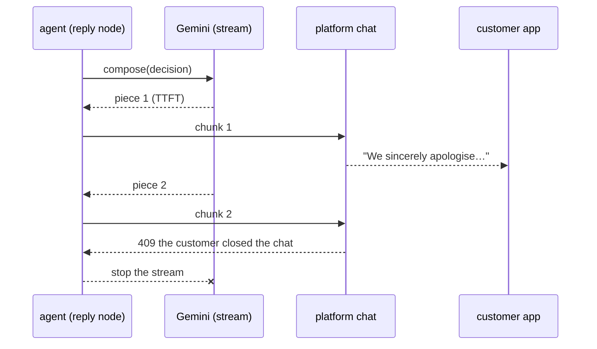
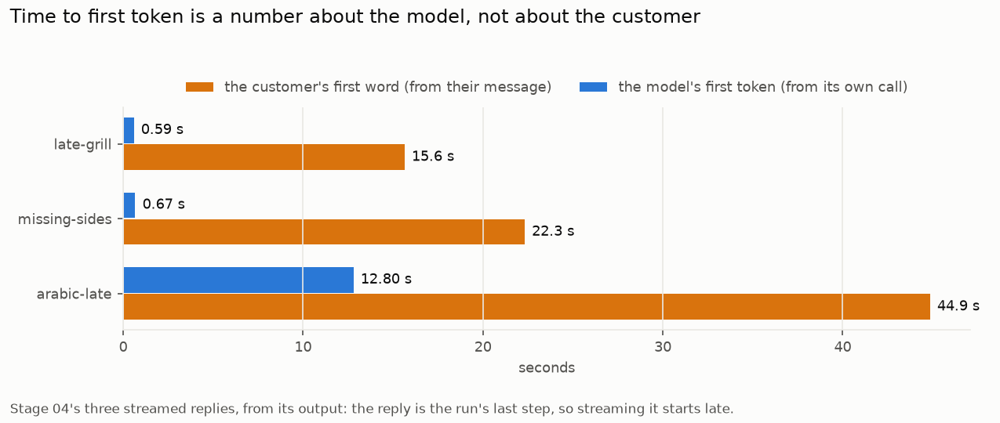

# 04 · Streaming

Until now the customer stared at an empty chat until the whole run finished, then got the whole reply at once. Chat products stream: the words appear as the model writes them. Streaming brings its own numbers and its own failure: **time to first token (TTFT)**, and a customer who closes the app halfway through.

The refund reply is now written by a streamed model call (`compose`), and each piece is pushed to the customer's chat as it arrives. If the customer has left, the platform answers `409`, and the agent **stops generating** (no paying for words nobody reads). It keeps what was said, and the note on the customer's record says the reply was cut off. The refund itself isn't undone: money and messages are separate.



## What changed

| Where | Change |
|---|---|
| Gemini client | `stream()`: pieces to a callback; returns the text, TTFT, total time, chunk count, and whether it was cut off |
| Platform | `POST /chat/{session}/chunks` (409 once the customer has left), `GET /chat/{session}`, `POST /chat/{session}/close`; fault `leave_after_chunks` |
| Agent | `reply` streams a fresh customer message (a fourth model judgment, `compose`) instead of the line `decide` wrote; the run records `reply.stream` |

## Run it

```bash
make platform
python 04-streaming/run.py             # stream | leave
```

## Real run (gemini-3.5-flash-lite, 2026-10-20)

| Case | Whole run | Model TTFT | Stream done | First word in the customer's app |
|---|---|---|---|---|
| late-grill | 15.9 s | 0.59 s | 0.79 s | 15.6 s |
| missing-sides | 22.6 s | 0.67 s | 0.93 s | 22.3 s |
| arabic-late | 45.1 s | **12.80 s** | 13.04 s | 44.9 s |

Customer leaves after the first piece ($640 late catering): the second piece got a 409, the stream stopped after 2 chunks, the chat shows "Hi there", the $640 was still paid, and the note ends "(the customer left before the reply finished)".



*Drawn from this stage's [`output.txt`](output.txt) by [`viz/batch_charts.py`](../viz/batch_charts.py).*

Full output: [`output.txt`](output.txt).

## What the numbers say

- **The model's TTFT is not the customer's TTFT.** Gemini started answering in 0.6 s, but the reply is the last step of the run, so the customer saw the first word after 15.6 s. Streaming only the last step hides almost nothing. To measure what the customer feels, you need the time from *their* message to *their* first word, across every step, not a number from one call.
- **One stream took 12.8 s to its first token** where the others took 0.6. Rate limit? A retry? A slow region? Nothing recorded says.
- **The Arabic reply said "riyal".** The order is in dollars; the model picked a currency that fits the language. The run passed, the customer was told the wrong currency, and only reading the reply catches it.

## Where it breaks

Every service so far either answers correctly or hangs. Real ones return 500s, half a record or nonsense, and the model itself returns invalid JSON or hits rate limits. The agent's only answer to most of that is a crash. Next: [05 · failures](../05-failures/).
