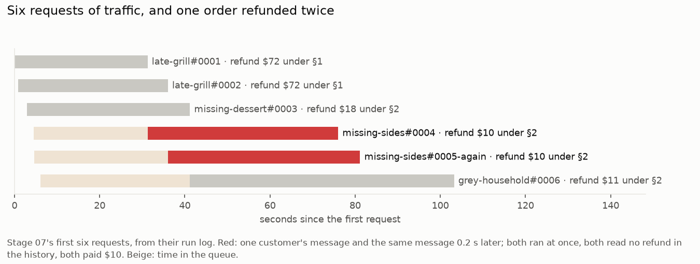
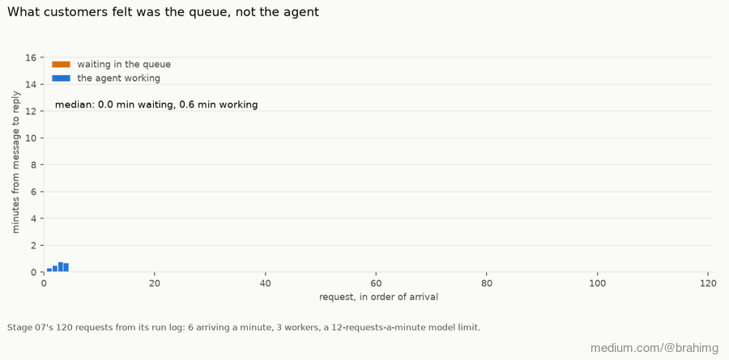
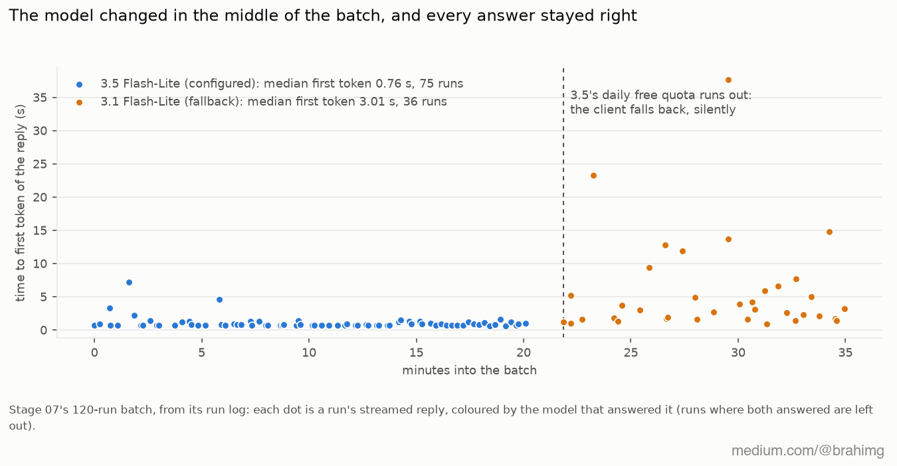

# 07 · Traffic

Eighteen hand-written messages, one at a time, say almost nothing about production. This stage sends the agent **traffic**: many customers, worded their own way, arriving at random, several at once.

[`agentkit/traffic.py`](../agentkit/traffic.py) builds each request from one of the cases:

- a **fresh order and customer**, cloned on the platform from the case (`POST /admin/clone`), with the original's fraud score, devices and refund history, so runs don't see each other's refunds;
- the message **reworded**: an opener ("URGENT:", "مرحبا، "), a closer, sometimes a typo, sometimes all lower case (`a-93100002`, which the order service didn't understand until classify learned to upper-case ids) or all capitals;
- about one customer in twelve **sends the same request again**, a few seconds later. If the first was refunded, the second must be refused (§7);
- arrivals follow a **Poisson process** (6 a minute by default) and **3 workers** serve them, so a busy minute builds a queue;
- **5% of runs** get a service fault injected (a 500, a hang, a broken record).

Every run is appended to a JSONL log ([`data/`](data/)): when it arrived, how long it queued, how long it ran, what it decided against what the case expects, tokens, cost, model events, guardrail verdicts, failures. [`report.py`](report.py) turns a log into what a dashboard would show, by hand.

## Run it

```bash
make platform
GEMINI_RPM=12 python 07-traffic/run.py 120          # about 40 minutes on the free tier
python 07-traffic/report.py 07-traffic/data/<batch>.jsonl
```

## The first six runs found a real bug

The first batch was a smoke test of 6 requests. Five were right. The sixth was a customer who sent the same message twice, 0.2 s apart, and **both requests were refunded**: two payments of $10 on one order, five seconds apart ([`data/2026-10-20-0134-first-6.jsonl`](data/2026-10-20-0134-first-6.jsonl)).

Both runs read the customer's history before either had paid, so both saw no refund. The idempotency key from part 1 (`<run>:refund`) stops one run from paying twice when it's replayed after a crash, but two *different* runs had two different keys. The fix: one key per order (`<order>:refund`). The second payment now comes back as `replayed`, no money moves, and that run tells the customer the order was already refunded. A test now runs two agents for one order at the same moment.

Eighteen one-at-a-time cases could never have found that.

## Real run (gemini-3.5-flash-lite, 2026-10-20)

120 requests from 18 cases (14 repeats), 6 a minute, 3 workers, model RPM limit 12, 5% with a fault ([`data/2026-10-20-0137.jsonl`](data/2026-10-20-0137.jsonl)):

| | |
|---|---|
| Throughput | 120 runs in 35.2 min: **3.4 served a minute against 6 arriving** |
| Correct | **118/120**. Both misses were `orders:bad` faults: the agent escalated, as it should, instead of the case's answer |
| Run time | p50 44.7 s · p95 95.2 s · p99 274.6 s |
| **Queue wait** | **p50 358.6 s · p95 795.7 s** (up to 13.6 minutes) |
| What the customer waited (queue + run) | p50 396 s · p95 843 s |
| Model | 389 calls, 178,548 tokens, $0.119 at list price ($0.99 per 1,000 runs) |
| Models used | 3.5 Flash-Lite 246 calls, **3.1 Flash-Lite 143** (3.5 Flash-Lite's daily free quota ran out mid-batch) |
| Model events | 23 × 503, 3 × daily quota exhausted, 3 fallbacks |
| Guardrails | input: 19 flagged, 0 false positives, 0 missed. Output: 4 flags |

What the numbers say:

- **The queue, not the agent, is what customers feel.** A run took 45 s at the median, but a customer waited 6.6 minutes from message to reply (queue + run), because arrivals outpaced the 12-requests-a-minute model limit. Per-run timings would never show it: the wait happens before the run starts.
- **The fallback model answered more than a third of the calls**, silently and correctly. Whether its answers are as good is something the case set alone can't say for every message.
- **A fault meant for one request hit another.** Faults are injected platform-wide, and with three workers in flight one run's broken order record was served to a different run. The log blames the wrong request; only per-request traces can say which call actually failed.
- **The output check is mostly wrong.** Of its 4 flags, one was real (riyal again, for a dollar refund) and **three were false positives**: replies that mentioned the $900 the customer demanded, the $32 that can't be refunded, the $500 approval limit. Those customers got a "correction" they didn't need. A guardrail's precision is something you only learn from traffic; part 4 measures it properly.
- Tail latency is in the sub-agents: the two grey-zone cases had p50s of 94 and 113 s, and the p99 run took 275 s.



*The first six requests, drawn from their run log ([`data/2026-10-20-0134-first-6.jsonl`](data/2026-10-20-0134-first-6.jsonl)) by [`viz/batch_charts.py`](../viz/batch_charts.py).*



*The 120-run batch, request by request, from its run log ([`data/2026-10-20-0137.jsonl`](data/2026-10-20-0137.jsonl)): orange is time waiting in the queue, blue the agent working. Frames drawn by [`viz/batch_charts.py`](../viz/batch_charts.py), assembled with ffmpeg.*



*Every run of the same batch, by the model that answered and its reply's time to first token, from the run log. The answers stayed right; only the latency gave the switch away.*

Full output: [`output.txt`](output.txt).

## Where it breaks

The log knows what each run decided, but not what the customer *thought* of it. And when something changes (a prompt edited, a model swapped), nothing in a run says which version produced it, so a better or worse week can't be traced to a change. Next: [08 · signals](../08-signals/).
